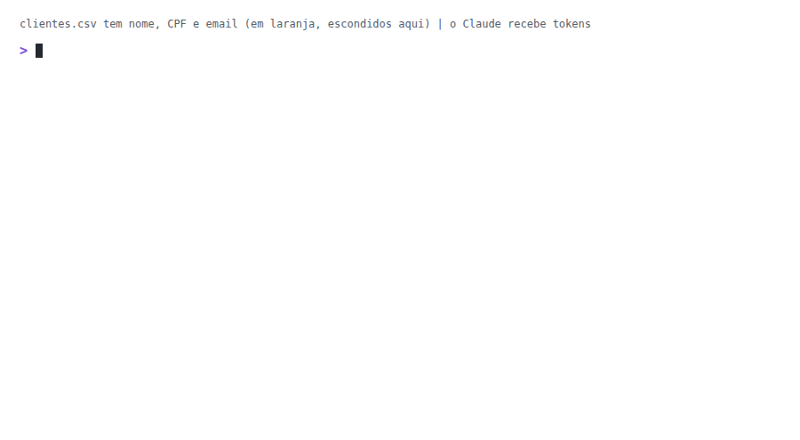
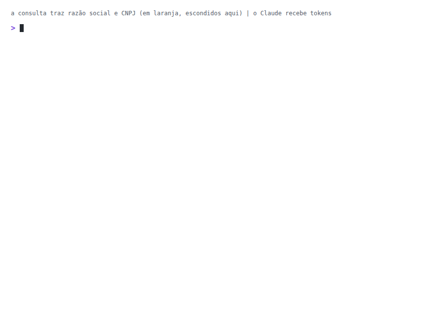
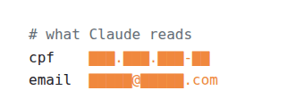

# pii-tokens

**Personal data out of Claude's context.**

A Claude Code plugin. Before Claude reads them, it swaps for tokens:

- Brazilian IDs (CPF, CNPJ), email and phone numbers.

- Same value, same token: Claude can still count, join and compare.
- The real value stays in an encrypted vault on your machine.

It reduces accidental leaks, it does not eliminate them. Before using it with real data, read the [limits](#limits).

| Where | Status | Left out |
|---|---|---|
| Claude Code (terminal, IDE) | ✅ Full | the [limits](#limits) |
| Claude Desktop, Code mode | ✅ Full (tested on Windows) | the [limits](#limits) |
| Claude Desktop, chat mode | 🟡 What an MCP returns, through the [extension](docs/desktop.en.md) (tested on Windows) | what you paste or attach |
| claude.ai | ❌ Not supported | everything |

<picture><source media="(prefers-color-scheme: dark)" srcset="docs/demo.gif"></picture>

[Leia em português](README.md)

## Install

Needs Python 3.10+ and, on Windows, Git for Windows. In Claude Code:

```
/plugin marketplace add oLucasAguilar/pii-tokens
/plugin install pii-tokens@pii-tokens
```

- On Windows, install Python from [python.org](https://www.python.org/downloads/), ticking "Add python.exe to PATH".

**Rather have Claude install it?** Paste into Claude Code (or Desktop's Code mode):

```
Install pii-tokens following https://github.com/oLucasAguilar/pii-tokens/blob/main/llms-install.md
```

It asks once before installing what is missing.

**Then:**

1. Restart Claude Code (in Desktop: Quit, and open it again).
2. Ask Claude to "run `pii-check` and read the file it names". The answer must show `CPF#...` and `EMAIL#...` in both parts, not the digits or the address.
    - Got the digits: restart and ask again. If it persists, open an [issue](https://github.com/oLucasAguilar/pii-tokens/issues) with the `pii-check` output and the version (`claude --version`).

Images are masked only with `tesseract` installed; without it, they pass with a warning.

## In practice

**A database query**

The real value is used only after you confirm.

<picture><source media="(prefers-color-scheme: dark)" srcset="docs/demo-banco.gif"></picture>

**Text in a file**, like a note or an email

```diff
- CPF <real CPF>, contact <real email>. Spoke with Maria.
+ CPF CPF#3f1a9c0d22e4, contact EMAIL#91bd0e4a7c13. Spoke with Maria.
```

A bare name in free text gets through: swap it for a nickname, add it to the term list, or turn on the names option.

**Claude's tools**, like Jira, Notion, a CRM or an internal API

You choose which fields stay readable.

```diff
  title: "Login error"               assignee: "A Teammate"
- client: "Acme Comercio Ltda"
+ client: "NAME#25aaae7143ac"
```

**Images**

- The hook reads the image text before Claude sees it, and draws tokens over the values.
- A pasted screenshot with a CPF, email or phone:
	1. The message is blocked, and a request to read the screenshot lands in your clipboard.
	2. Press Ctrl+V and Enter.
	3. Claude reads the screenshot with the data swapped for tokens.
- A screenshot saved to a file: ask Claude to read the file, and it arrives with tokens.

**When you need the real value**

```bash
pii-exec -- grep CPF#3f1a9c0d22e4 app.log   # uses the real CPF; the output comes back masked
pii-reveal report.md                        # opens the real version in your editor, away from Claude
```

Commands and settings: [docs/usage.en.md](docs/usage.en.md).

**Claude Desktop**

In Desktop chat, hooks do not run. For an MCP server there, use the Desktop extension, which masks only what the server returns: [docs/desktop.en.md](docs/desktop.en.md).

## What gets masked

<picture><source media="(prefers-color-scheme: dark)" srcset="docs/tokens-en-dark.gif"></picture>

| Data | Token |
|---|---|
| CPF and CNPJ (with valid check digits) | `CPF#`, `CNPJ#` |
| Email, outside the domains you allow | `EMAIL#` |
| Brazilian phone numbers | `PHONE#` |
| Name, contact and document columns (table, CSV, JSON) | `NAME#`, `CONTACT#`, `DOC#` |
| Terms you list, such as a client's name | `TERM#` |

With the option on (off by default, in `/plugin configure`):

| Option | What it replaces | Token |
|---|---|---|
| Mask IP addresses | IPv4 address | `IP#` |
| Mask names in free text | a common first name + surname, like "Maria Souza" | `NAME#` |

## Limits

It protects against accidental leaks, not against a model set on extracting the data.
Whatever the detector does not recognize goes through as is: review before sending sensitive data.

These get through unmasked:

- names in free text, unless in the term list or caught by the names option;
- failing commands and `!` commands;
- keys, passwords and API tokens (the plugin handles personal data).

Also:

- In images, OCR finds almost every CPF and CNPJ, not all of them.
- A token is a pseudonym, not anonymous.

Full list, before using it with real data: [docs/limits.en.md](docs/limits.en.md).

## What about the others?

On 2026-10-22 we found no other tool that:

- swaps data for a reversible token;
- understands Brazilian documents;
- runs inside Claude Code.

Comparison: [docs/alternatives.md](docs/alternatives.md).
