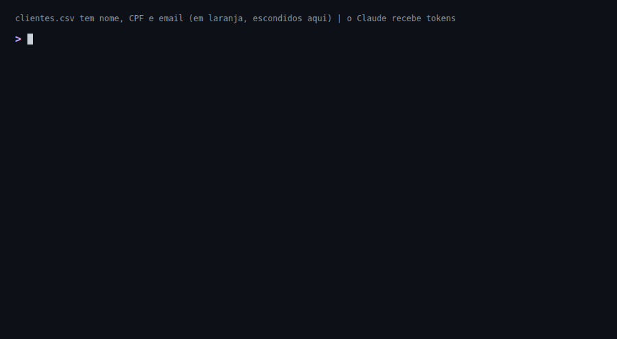
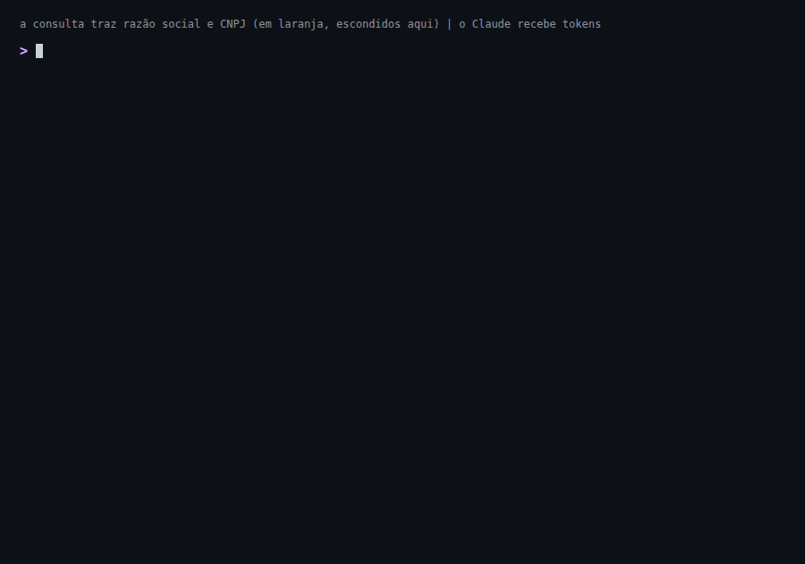

# pii-tokens

**Dado pessoal fora do contexto do Claude.**

Plugin do Claude Code. Troca CPF, CNPJ, email e telefone por tokens antes de o Claude ler. Mesmo valor, mesmo token: ele ainda conta, cruza e compara. O valor real fica num cofre cifrado na sua máquina.



[Read in English](README.en.md)

## Instalar

```
/plugin marketplace add oLucasAguilar/pii-tokens
/plugin install pii-tokens@pii-tokens
```

Reinicie e peça ao Claude: "roda o `pii-selfcheck`". Tem de terminar em `all good`. Linux ou macOS, Python 3.10+.

## Na prática

**Consulta ao banco, e o valor real só com a sua confirmação**



**Card de suporte colado num arquivo**

```diff
- CPF <CPF real>, contato <email real>. Falou com a Maria.
+ CPF CPF#3f1a9c0d22e4, contato EMAIL#91bd0e4a7c13. Falou com a Maria.
```

Nome solto no texto passa: troque por um apelido.

**Board do Monday:** você escolhe o que fica legível

```diff
  name: "Boleto não baixou"        responsável: "Colega do Time"
- cliente: "Padaria Exemplo LTDA"
+ cliente: "NAME#25aaae7143ac"
```

**Precisa do valor real**

```bash
pii-exec -- grep CPF#3f1a9c0d22e4 app.log   # roda com o CPF real; a saída volta mascarada
pii-reveal relatorio.md                     # abre a versão real no seu editor, longe do Claude
```

Comandos e configurações: [docs/usage.md](docs/usage.md).

## O que é mascarado

| Dado | Token |
|---|---|
| CPF e CNPJ (com dígito verificador válido) | `CPF#`, `CNPJ#` |
| Email, fora dos domínios que você liberar | `EMAIL#` |
| Telefone brasileiro | `PHONE#` |
| Colunas de nome, contato e documento (tabela, CSV, JSON) | `NAME#`, `CONTACT#`, `DOC#` |

## Limites

Protege contra vazamento por descuido, não contra um modelo decidido a extrair o dado.

- Nome em texto livre, comando que falha, comando com `!` e imagem passam.
- Chave, senha e token de API passam: o plugin cuida de dado pessoal.
- O token é pseudônimo, não anônimo.

Lista completa, antes de usar com dado real: [docs/limits.md](docs/limits.md).

## E os outros?

Em 22/10/2026 não achamos outro que troque por token reversível, entenda documento brasileiro e rode dentro do Claude Code. Comparação: [docs/alternativas.md](docs/alternativas.md).
