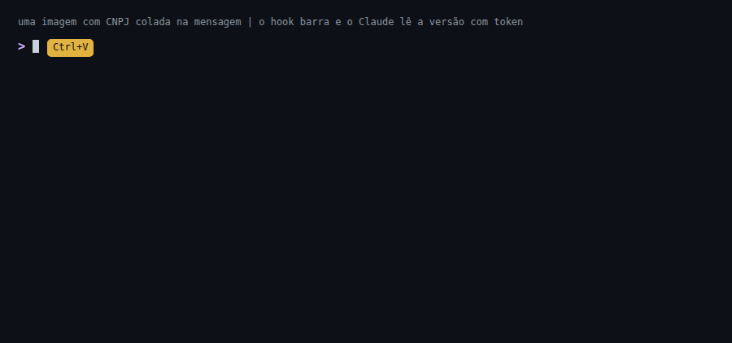
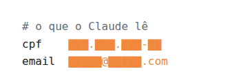

# pii-tokens

**Dado pessoal fora do contexto do Claude.**

Plugin do Claude Code. Troca CPF, CNPJ, email e telefone por tokens antes de o Claude ler.

- Mesmo valor, mesmo token: o Claude ainda conta, cruza e compara.
- O valor real fica num cofre cifrado na sua máquina.


[Read in English](README.en.md)

## Instalar

```
/plugin marketplace add oLucasAguilar/pii-tokens
/plugin install pii-tokens@pii-tokens
```

1. Reinicie o Claude Code.
2. Peça: "roda o `pii-selfcheck`". Tem de terminar em `all good`.

Requer Linux ou macOS e Python 3.10+.
Para mascarar imagem, instale o `tesseract`:

```
apt install tesseract-ocr   # ou: brew install tesseract
```

## Na prática

**Consulta ao banco**

O valor real só é usado com a sua confirmação.


**Texto num arquivo**, como uma anotação ou um email

```diff
- CPF <CPF real>, contato <email real>. Falou com a Maria.
+ CPF CPF#3f1a9c0d22e4, contato EMAIL#91bd0e4a7c13. Falou com a Maria.
```

Nome solto no texto passa: troque por um apelido, ou ponha o nome na lista de termos.

**Ferramentas do Claude**, como Jira, Notion, um CRM ou uma API interna

Você escolhe que campo fica legível.

```diff
  titulo: "Erro no login"            responsável: "Colega do Time"
- cliente: "Acme Comercio Ltda"
+ cliente: "NAME#25aaae7143ac"
```

**Imagem**



O hook lê o texto da imagem antes de o Claude ver.

- CPF, CNPJ, email e telefone recebem o token desenhado por cima.
- Imagem colada na mensagem, com dado pessoal:
	- a mensagem é barrada;
	- o pedido para ler o arquivo vai para a área de transferência;
	- apague, cole e envie.
- Sem o `tesseract`, a imagem passa, com aviso.

**Precisa do valor real**

```bash
pii-exec -- grep CPF#3f1a9c0d22e4 app.log   # usa o CPF real; a saída volta mascarada
pii-reveal relatorio.md                     # abre a versão real no seu editor, longe do Claude
```

Comandos e configurações: [docs/usage.md](docs/usage.md).

## O que é mascarado

<picture><source media="(prefers-color-scheme: dark)" srcset="docs/tokens-pt-dark.gif"></picture>

| Dado | Token |
|---|---|
| CPF e CNPJ (com dígito verificador válido) | `CPF#`, `CNPJ#` |
| Email, fora dos domínios que você liberar | `EMAIL#` |
| Telefone brasileiro | `PHONE#` |
| Colunas de nome, contato e documento (tabela, CSV, JSON) | `NAME#`, `CONTACT#`, `DOC#` |
| Termos que você listar, como o nome de um cliente | `TERM#` |
| IP, se você ligar a opção | `IP#` |

## Limites

Protege contra vazamento por descuido, não contra um modelo decidido a extrair o dado.
O que o detector não reconhece passa como está: revise antes de enviar dado sensível.

Funciona no Claude Code. No chat do Claude Desktop e no claude.ai, hook não roda e nada é mascarado. A extensão para o chat do Desktop está em desenvolvimento.

Passam sem máscara:

- nome em texto livre, fora da lista de termos;
- comando que falha e comando com `!`;
- chave, senha e token de API (o plugin cuida de dado pessoal).

Também:

- Em imagem, o OCR acha quase todo CPF e CNPJ, não todos.
- O token é pseudônimo, não anônimo.

Lista completa, antes de usar com dado real: [docs/limits.md](docs/limits.md).

## E os outros?

Em 22/10/2026 não achamos outro plugin que:

- troque o dado por token reversível;
- entenda documento brasileiro;
- rode dentro do Claude Code.

Comparação: [docs/alternativas.md](docs/alternativas.md).
